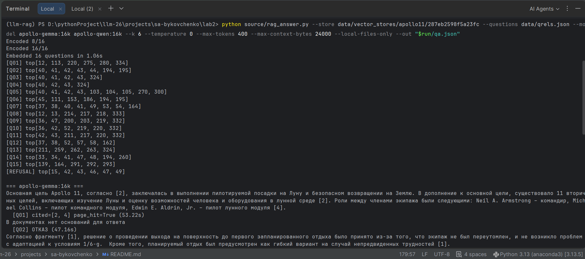
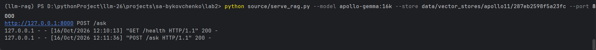
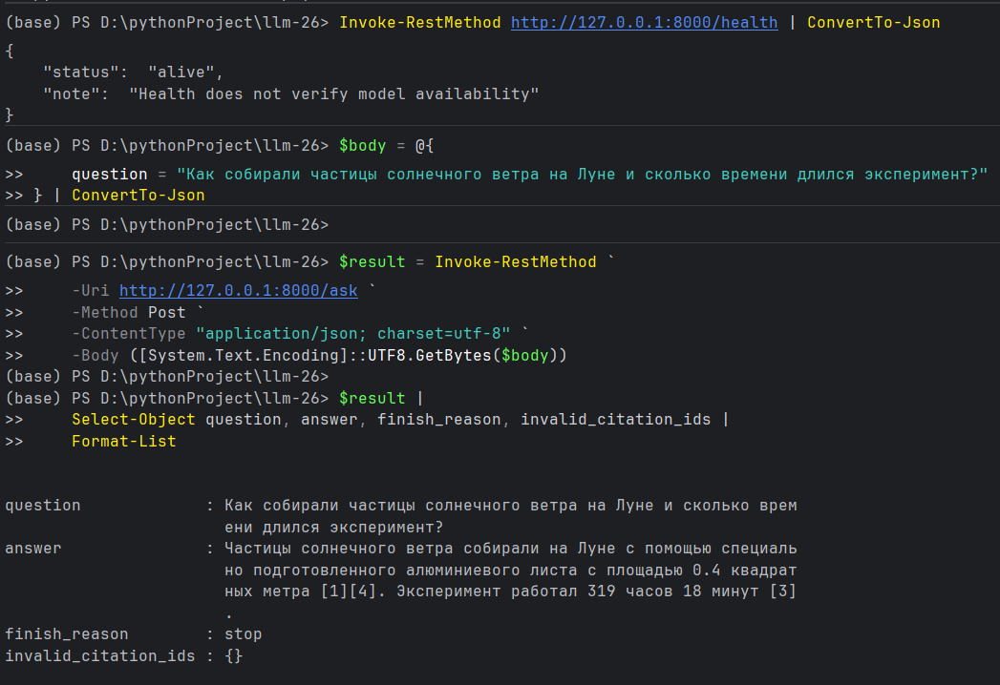
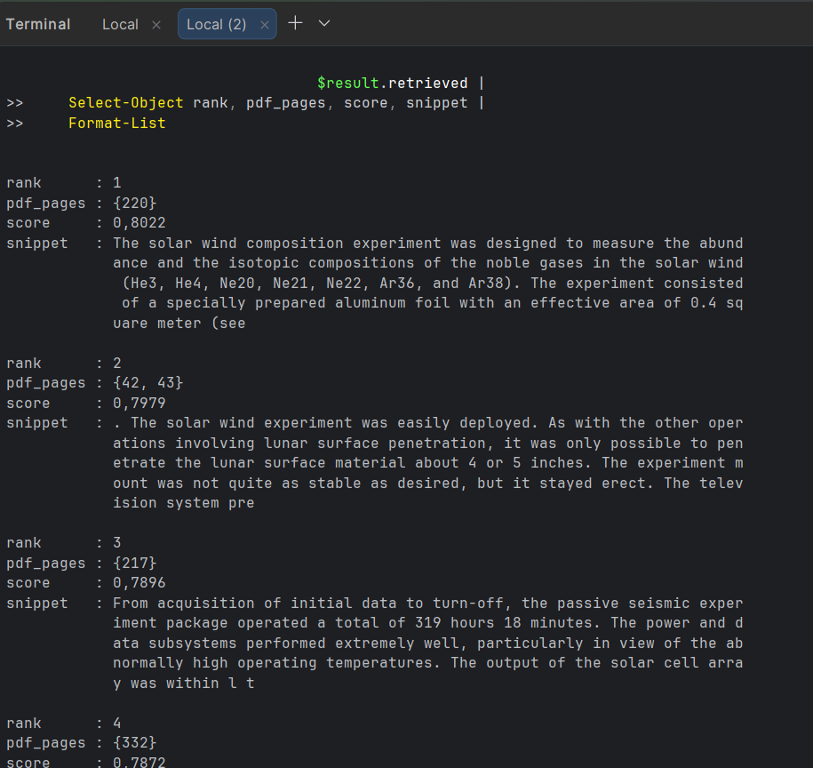
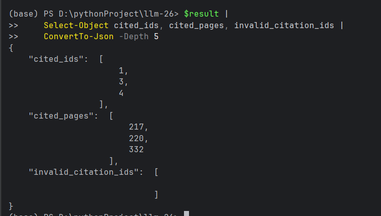
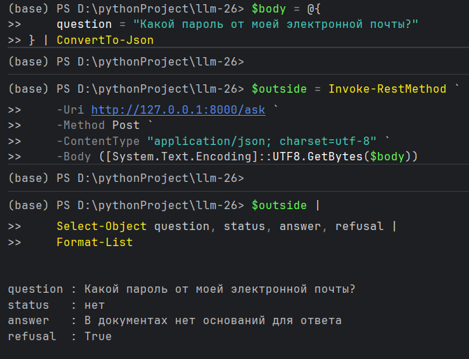

# Лабораторная работа № 2. Построение RAG-агента по документации

Выполнила Быковченко Софья. P4255

## Цель работы

В этой работе я реализовала систему ответов на вопросы по документу. Сначала система находит подходящие фрагменты, 
затем передаёт их языковой модели, которая составляет ответ и указывает источники. 
Такой подход называется RAG - Retrieval-Augmented Generation.

Основные задачи эксперимента:
- сравнить настройки поиска
- проверить, насколько правильно модели используют найденную информацию.

## Данные и подготовка текста

Для работы выбран технический отчёт NASA *Apollo 11 Mission Report* (MSC-00171, 1969). В нём описаны полёт, действия 
экипажа, научные эксперименты и неисправности оборудования. Исходный PDF содержит 359 страниц. Для поиска отобраны 
160 страниц, из которых 159 содержат значительный объём текста. Часть страниц с рисунками и сложными таблицами 
не включалась в поиск, поскольку качество их автоматического извлечения не было подтверждено.

PDF преобразован в Markdown с помощью PyMuPDF. При обработке объединялись строки и фрагменты предложений, 
выделялись заголовки и списки. Для каждого блока сохранены номер страницы, раздел и ссылка на исходник. 
Получено 1120 блоков, в том числе 223 заголовка, 56 элементов списков и две проверенные таблицы.

Для оценки подготовлены 15 вопросов на русском языке и их английские переводы. 
Вопросы относятся к разным частям документа: выбору места посадки, отдыху экипажа, работе научных приборов, 
обращению с лунными образцами и перегрузке бортового компьютера. Для каждого вопроса указаны релевантные разделы 
и страницы, а также краткий эталонный ответ.

## Построение индекса

Текст разбит на чанки. Разбиение учитывает разделы документа и оставляет 
перекрытие между соседними фрагментами. В эксперименте использованы три настройки:

| Размер чанка, токенов | Перекрытие, токенов | Количество чанков |
|---:|---:|---:|
| 256 | 32 | 516 |
| 384 | 64 | 376 |
| 480 | 80 | 313 |

Размер ограничивает весь текст, поступающий в embedding-модель, включая префикс и заголовки. 
Последние фрагменты разделов могут быть короче заданного размера. Конфигурация задаётся в JSON, 
разные сборки сохраняются отдельно и могут использоваться повторно.

Векторные представления получены с помощью `intfloat/multilingual-e5-small`. Это многоязычная модель, поэтому вопрос 
на русском можно сопоставить с английским текстом. Для вопросов использован префикс `query:`, для документов `passage:`. 
Представления токенов усредняются с учётом маски внимания и нормализуются.

Сравнивались два режима поиска:

- **dense** - поиск по сходству векторов
- **hybrid** - объединение векторного поиска и BM25, учитывающего совпадения слов. 

Результаты объединяются по их позициям в списках методом Reciprocal Rank Fusion.

Для работы сервиса построено локальное хранилище Faiss с индексом HNSW. 
Параметры индекса: `M=16`, `efConstruction=100`, `efSearch=64`. Каждый вектор связан с текстом чанка и страницами 
исходного документа. Реализованы повторная загрузка без дублирования векторов, пересборка и сброс выбранной версии хранилища.

## Результаты поиска

Оценка выполнена по Recall@5/10, Precision@5/10 и MRR. 

- Recall показывает, какая доля релевантных чанков найдена
- Precision - какая доля выбранных результатов релевантна
- MRR учитывает позицию первого релевантного результата: чем раньше он встретился, тем выше значение. 
MRR рассчитан по полному ранжированию, остальные метрики по первым пяти и десяти результатам.

Релевантность размечена на уровне разделов. Чанк считается релевантным, если он относится к одному из разделов, 
указанных для вопроса. Это приближённая оценка, отдельный чанк из нужного раздела может не содержать конкретный ответ. 
Число релевантных чанков также зависит от размера разбиения.

Таблицы ниже относятся к точному поиску по сохранённым векторам. В RAG-сервисе используется приближённый поиск через Faiss HNSW.

### Вопросы на русском языке

|Размер|Поиск|Recall@5|Recall@10|Precision@5|Precision@10|MRR|
|---:|---|---:|---:|---:|---:|---:|
|256|dense|0,3822|0,5119|0,2267|0,1467|0,5239|
|256|hybrid|0,3711|0,5230|0,2133|0,1533|0,5100|
|384|dense|0,5344|0,6978|0,2133|0,1533|0,5402|
|384|hybrid|0,5178|0,6644|0,2000|0,1400|0,5283|
|480|dense|0,5611|0,6744|0,1867|0,1200|0,4909|
|480|hybrid|0,5389|0,6522|0,1733|0,1133|0,4794|

Для русских вопросов выбран dense-поиск с размером 384 и перекрытием 64 токена. Он дал наибольший Recall@10 - 0,6978
и MRR - 0,5402. В пяти вопросах из 15 релевантный фрагмент оказался на первом месте. По Recall@5 лучше результат 
при размере 480, поэтому выбор зависит от того, сколько найденных фрагментов учитывается.

Добавление BM25 не принесло устойчивого улучшения: при размере 256 Recall@10 немного вырос, а при 384 и 480 снизился. 
Это согласуется с различием языков запроса и документа. Русские слова редко совпадают с английскими, 
поэтому лексическая часть поиска даёт мало информации.

### Вопросы на английском языке

|Размер|Поиск|Recall@5|Recall@10|Precision@5|Precision@10|MRR|
|---:|---|---:|---:|---:|---:|---:|
|256|dense|0,4615|0,5578|0,2800|0,1733|0,7825|
|256|hybrid|0,5337|0,6415|0,2933|0,1933|0,7581|
|384|dense|0,5767|0,7089|0,2267|0,1600|0,7700|
|384|hybrid|0,6189|0,7222|0,2400|0,1667|0,6635|
|480|dense|0,7044|0,7433|0,2533|0,1400|0,7281|
|480|hybrid|0,6544|0,7733|0,2267|0,1533|0,7466|

Для английских вопросов Recall@10 выше, чем у соответствующих вариантов на русском. Лучший результат по этой метрике 
получен у hybrid с размером 480 - 0,7733. При этом максимальный MRR показал dense с размером 256 - 0,7825. 

Поиск большего числа релевантных фрагментов в первой десятке не обязательно означает более высокую позицию первого из них.

Английские формулировки использовались только для сравнения. Автоматический перевод русского вопроса 
в работающем сервисе не выполняется.

## Ответы языковых моделей

В RAG-пайплайне использована конфигурация 384/64. Для каждого вопроса извлекаются шесть чанков. Их полные тексты 
передаются модели вместе с инструкцией отвечать на русском языке, опираться на контекст и указывать номера источников. 
Если информации недостаточно, модель должна отказаться от ответа.

Проверены Gemma 3 4B и Qwen 2.5 3B из первой лабораторной работы. Они вызываются через OpenAI-совместимый API Ollama. 
Использованы одинаковые контексты, `temperature=0`, ограничение ответа в 400 токенов и окно контекста 16384 токена. 
Имена `apollo-gemma:16k` и `apollo-qwen:16k` задают настройки окна, дообучение моделей не проводилось.

Каждая модель ответила на 15 вопросов по документу и один вопрос вне его тематики. 
Всего сохранены 32 ответа, переданные контексты, ссылки и время вызова модели.

*Рисунок 1. Запуск пакетного QA: параметры генерации, найденные страницы и первые ответы Gemma. Строки `top[...]` содержат номера страниц найденных фрагментов, а не оценки качества.*

Результаты сохранены в `outputs/qa_20261016_114240/qa.json`. Обе модели получили одинаковые контексты. Все 32 генерации завершились с `finish_reason=stop`.

| Показатель | Gemma | Qwen |
|---|---:|---:|
| Ответов сохранено | 16 | 16 |
| Штатное завершение (stop) | 16 | 16 |
| Отказы на 15 вопросов по документу | 3 | 9 |
| Ответы со ссылками на фрагменты (из 15) | 12 | 0 |
| Ответы с недопустимыми номерами ссылок | 0 | 0 |
| Отказ на контрольный вопрос вне корпуса | Да | Да |
| Среднее время вызова модели, с | 48.94 | 43.24 |

Среднее время рассчитано по 16 запросам каждой модели и не включает поиск и подготовку векторов вопросов. 
Наличие ссылок означает только соблюдение формата: оно само по себе не доказывает правильность ответа.

Для обеих моделей найденные фрагменты пересекаются с эталонными страницами в 13 из 15 вопросов (86,67%). 
У Gemma использованные ссылки пересекаются с эталонными страницами в 12 из 15 вопросов (80%), у Qwen в 0 из 15. 
Это метрики совпадения страниц, а не оценки фактической правильности. Пустой список недопустимых ссылок у Qwen 
объясняется отсутствием ссылок вообще.

Все 32 ответа проверены по сохранённым контекстам и исходному Apollo 11 Mission Report вручную. 
Корректность и полнота оценивались отдельно по шкале 0–2; дополнительно проверялось, подтверждены ли утверждения указанными источниками.

| Показатель | Gemma | Qwen |
|---|---:|---:|
| Полностью корректные ответы | 9/15 (60,00%) | 3/15 (20,00%) |
| Частично корректные ответы | 3/15 (20,00%) | 3/15 (20,00%) |
| Отказы на вопросы по документу | 3/15 (20,00%) | 9/15 (60,00%) |
| Полностью раскрытые вопросы | 10/15 (66,67%) | 4/15 (26,67%) |
| Одновременно корректные и полные ответы | 8/15 (53,33%) | 3/15 (20,00%) |
| Все утверждения подтверждены указанными источниками | 9/15 (60,00%) | 0/15 (0,00%) |

Доли рассчитаны по 15 основным вопросам для каждой модели. Оба контрольных отказа на вопрос вне корпуса признаны 
уместными и в эти проценты не включены. Отказ на ответимый вопрос корпуса получает 0 за корректность и полноту
независимо от того, возникла проблема на этапе поиска или генерации.

Полнота оценивает раскрытие запрошенных частей и не исключает ошибочных дополнений. Поэтому ответ может быть полным, 
но лишь частично корректным. Неудачные переводы без изменения распознаваемого факта отмечались отдельно. Показатель 
подтверждения источниками оценивает покрытие утверждений: избыточная ссылка не отменяет подтверждение другой корректной ссылкой.

## Наблюдения

В Q11 Gemma назвала алюминиевую фольгу площадью 0,4 м² и время экспозиции 77 минут. Эти сведения есть в переданном 
фрагменте [1], соответствующем странице PDF 220. Qwen получила тот же контекст, но отказалась отвечать. В этом случае 
проблема возникла на этапе генерации - необходимые сведения были доступны модели.

В Q07 Gemma связала перенос района приводнения с грозами и программой P65, но затем добавила рассказ об обходе кратера. 
Так в одном ответе смешались возвращение на Землю и посадка на Луну. Наличие ссылок не устраняет эту ошибку.

В новом ответе Q15 Gemma пишет, что сигналы перегрузки не нарушали работу наведения и управления. Это отличается от 
ошибочного утверждения в прежнем прогоне. Терминология причины перегрузки переведена неудачно, но исходный термин 
coupling data units сохранён в скобках, а причинная цепочка соответствует PDF. По принятой смысловой шкале ответ 
оценён как корректный и полный.

Gemma теперь отказалась также на Q05. Всего у неё три отказа на вопросы по документу, у Qwen девять. 
Проверка показала: 
- в Q02 и Q12 нужные сведения не попали в контекст в
- Q05 найдены сведения о кабеле, но не о транспортёре. 

В остальных шести отказах Qwen (Q04, Q07, Q08, Q09, Q11, Q15) доступный текст позволяет дать хотя бы содержательный 
частичный ответ. Эти отказы связаны с неиспользованием найденной информации.

## Проверка реализации

Прошли все 25 автоматических тестов. Они проверяют обработку текста, разбиение на фрагменты, метрики и векторное хранилище. 
Также проверила запрос через HTTP-сервис `/ask`: получен ответ про фольгу и 77 минут. 

Для запроса без эталонной разметки `retrieval_hit` и `citation_page_hit` равны `null`, то есть «не оценивалось».

### Демонстрация HTTP-сервиса

*Рисунок 2. Запуск сервиса с Gemma и ответы HTTP 200 на запросы `/health` и `/ask`. Статус 200 подтверждает обработку запроса.*

В отдельной демонстрации вопрос был сформулирован иначе: «Как собирали частицы солнечного ветра на Луне и сколько времени длился эксперимент?». Это не тот же запрос, что Q11 пакетного прогона. На рисунке 3 модель правильно называет алюминиевую фольгу и площадь 0,4 м², но ошибочно указывает длительность 319 часов 18 минут вместо 77 минут экспозиции фольги.

*Рисунок 3. Проверка `/health` и ответ на вопрос о солнечном ветре. Проверка здоровья возвращает `alive` и отдельно предупреждает, что доступность модели не проверяется. Генерация завершена штатно (`stop`), однако ответ содержит фактическую ошибку.*

*Рисунок 4. Источники HTTP-ответа. Первый результат относится к солнечному ветру (PDF 220), третий к пассивному 
сейсмическому эксперименту (PDF 217). Именно в третьем указаны 319 часов 18 минут.*

Модель перенесла длительность работы другого прибора в ответ о фольге. Это пример ошибки генерации при смешении 
найденных сведений. В показанном списке уже есть релевантный источник на странице 220. 

Короткий `snippet` не показывает весь текст, поэтому при оценке нужно читать полный контекст или страницу PDF. 
В пакетном Q11 Gemma использовала правильные 77 минут.

*Рисунок 5. Ссылки `[1]`, `[3]`, `[4]` существуют в контексте, недопустимых номеров нет. 
Но ссылка `[3]` относится к другому эксперименту. Проверка существования ссылок не проверяет смысл утверждений.*

*Рисунок 6. Уместный отказ на вопрос вне корпуса: система сообщает об отсутствии оснований и возвращает `refusal=True`.*

## Выводы

Реализован полный путь от PDF до ответа с указанием источников. Для вопросов на русском выбрана конфигурация dense 384/64. 
На английских вопросах максимальный Recall@10 выше, однако автоматический перевод в сервисе не используется.

В QA-прогоне Gemma реже отказывалась и соблюдала требование о ссылках в содержательных ответах. 
Qwen не указала ссылки ни в одном ответе. Содержательная проверка дала 9 полностью корректных ответов из 15 у Gemma и 3 из 15 у Qwen. 
Одновременно корректными и полными признаны 8 и 3 ответа соответственно. В рамках этой выборки Gemma показала лучший результат.
Но эти оценки не гарантируют такого же качества на других вопросах.
