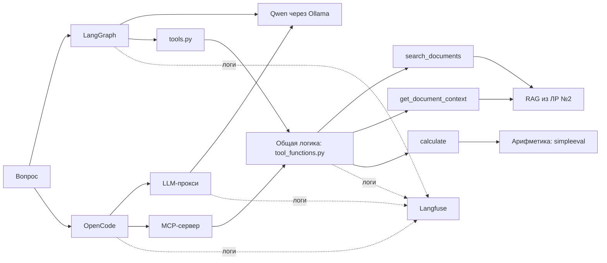
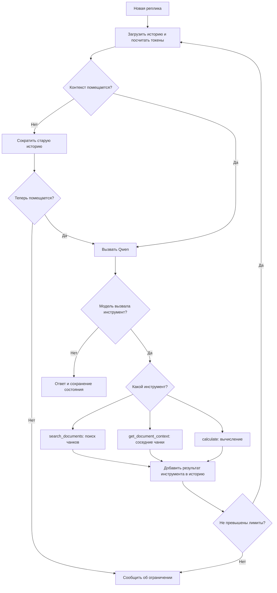
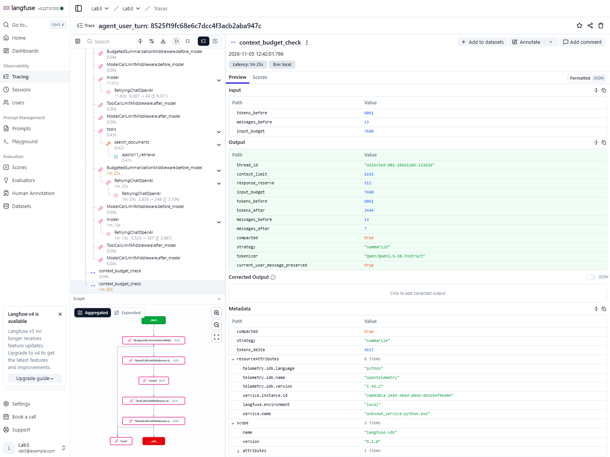
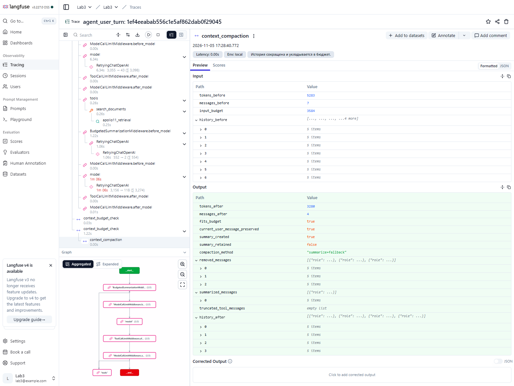
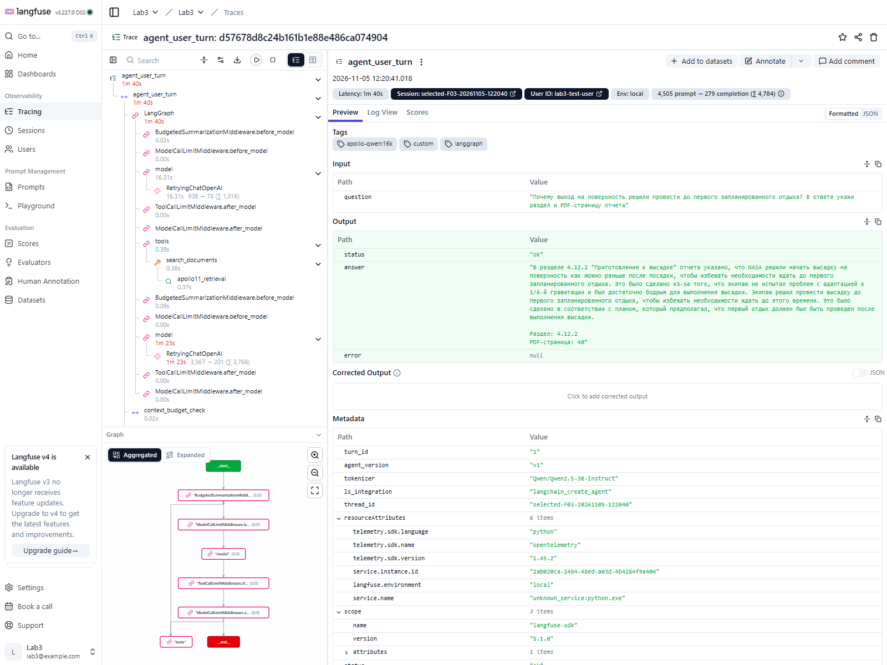

# Лабораторная работа №3. Диалоговый агент на LangGraph и сравнение с OpenCode

## Описание задания

В этой работе я сделала диалогового агента, который отвечает на вопросы по отчёту NASA *Apollo 11 Mission Report*, 
и сравнила его с готовым агентом OpenCode. За основу взяла RAG из прошлой лабораторной: 
он уже умеет находить нужные фрагменты PDF и возвращать их вместе с номерами разделов и страниц.

От обычного RAG здесь требовалось перейти к агенту: модель должна сама выбирать инструмент, при необходимости делать 
несколько вызовов подряд, помнить предыдущие реплики и не выходить за заданный лимит контекста. 
Кроме того, нужно было записывать выполнение в Langfuse, чтобы разбирать не только ответ, но и путь к нему.

Для сравнения я использовала **одну модель Qwen 2.5 3B и общую реализацию инструментов**. 
Различалась агентная оболочка: собственная сборка на LangGraph или OpenCode с доступом к инструментам через MCP.

Набор для итогового сравнения — **15 заданий, 23 реплики**: 13 одиночных вопросов и два диалога по пять реплик. 
В нём есть вопросы на поиск фактов, объединение нескольких сведений, вычисления, отсутствие ответа в документе 
и работу с историей.

## Использованные технологии и модели

| Технология | Для чего использовалась |
|---|---|
| **Qwen 2.5 3B, Ollama** | Локальная LLM для обоих агентов (`apollo-qwen:16k`) |
| **LangChain / LangGraph** | Собственный агент: цикл модели и инструментов, память, ограничения и middleware |
| **OpenCode** | Готовый агент для сравнения |
| **FastMCP** | Передача тех же инструментов OpenCode через MCP-сервер |
| **Langfuse, Docker Compose** | Локальное хранение трейсов, вызовов модели и инструментов, оценок |
| **Transformers** | Токенизатор Qwen для контроля размера контекста |
| **Pydantic, simpleeval** | Проверка аргументов инструментов и вычисления |
| **RAG из ЛР №2** | Поиск по PDF: BM25, эмбеддинги multilingual-e5-small и FAISS/HNSW |

Основные настройки находятся в `config/agent.yaml`, а системные промпты и описания инструментов в `prompts/` и `config/tools.yaml`. 
В итоговом запуске модель Qwen задавалась явно через `--model`: модель по умолчанию в YAML может отличаться.

## Результаты работы

### Как устроены агенты

Для собственного агента я использовала `create_agent()` из LangChain. 
Граф выполнения, хранение состояния и переходы между моделью и инструментами обеспечивает LangGraph. 
Сборка агента находится в `source/agent.py`, запуск реплик в `source/run_agent.py`.

Доступны три инструмента:

- `search_documents` ищет сведения в RAG из второй лабораторной
- `get_document_context` по `chunk_id` возвращает найденный фрагмент и соседний текст той же страницы и раздела
- `calculate` вычисляет арифметическое выражение

Их общая логика находится в `source/tool_functions.py`. LangGraph получает инструменты через `source/tools.py`, 
а OpenCode - через `source/mcp_server.py`.



На каждом шаге LangGraph сначала проверяет контекст, затем передаёт сообщения модели. 
Если модель запрашивает инструмент, он выполняется, результат добавляется в историю, и модель вызывается снова. 
Если инструмент не нужен, возвращается ответ. Число вызовов модели и инструментов ограничено, для ошибок инструментов 
предусмотрены обработка и повтор при временном сбое.



Для памяти используется checkpointer LangGraph. Реплики одного диалога передаются с одним `thread_id`, 
поэтому модель может учитывать прошлые вопросы, ответы и результаты инструментов. Для экспериментальных прогонов
использовалась память в процессе, в обычном режиме предусмотрено сохранение в SQLite.

### Ограничение контекста и сокращение истории

У собственного агента выставлен лимит **8192 токена**, из которых **512 зарезервированы под ответ**. 
Перед каждым обращением к модели контекст считается токенизатором Qwen с учетом шаблона сообщений и описаний 
инструментов (`source/context_budget.py`). Пока история помещается, она сохраняется целиком. 
При превышении запускается `SummarizationMiddleware` - старые сообщения заменяются краткой сводкой. 
После выявленной проблемы с большими результатами инструментов был добавлен резервный способ сокращения.

В основном эксперименте сокращение произошло в диалоге D01, на четвёртой реплике:

| До | После |
|---|---|
| 8061 токен | 3444 токена |
| 13 сообщений | 7 сообщений |

Агент продолжил работу, но ответил неправильно: сослался на раздел 4.11 вместо 4.12.3–4.12.4. 
Это произошло после сокращения. Утверждать, что именно оно вызвало ошибку, без контрольного запуска нельзя.



В D02 при основном лимите 8192 сокращение не понадобилось. Поэтому я отдельно проверила оба длинных диалога 
с лимитом **4096 токенов** (3584 на вход). В этом тесте агент успешно продолжил все реплики:

| Диалог и реплика | Токены до → после | Что произошло |
|---|---|---|
| D01, реплика 3 | 3648 → 1405 | Суммаризация и резервное сокращение |
| D02, реплика 2 | 5283 → 3280 | Суммаризация и резервное сокращение |
| D02, реплика 4 | 3624 → 1560 | Суммаризация |

Ошибки переполнения контекста в этом проверочном прогоне не было. Это подтверждает техническую работоспособность 
механизма при лимите 4096, но не гарантирует, что после сокращения сохраняются все факты, необходимые для точного ответа.



### 3.3. Сравнение на заданном наборе

Оба агента прошли один и тот же список из 15 заданий. Результаты сохранены в `outputs/final_langgraph_qwen.json` и `outputs/final_opencode_qwen.json`.

`Strict success` означает полностью выполненную задачу, включая обязательные факты и ссылки. 
`Partial` допускает частично правильный ответ. `Citation` оценивается от 0 до 2. 

Статус `ok` означает, что агент технически закончил реплику, **но не то, что ответ верный**.

| Показатель | LangGraph | OpenCode |
|---|---:|---:|
| Полностью решено задач | **4/15 (26,7%)** | **4/15 (26,7%)** |
| Средний Partial | **0,740** | **0,400** |
| Средняя оценка ссылок (0–2) | 0,619 | 0,238 |
| Правильные ответы с зависимостью от истории | 4/6 | 3/5 |
| Корректность использования инструментов | 12/15 | 8/15 |
| Успешно обработанных реплик (`ok`) | 22 | 15 |
| Таймауты | 0 | 6 |
| Пустые ответы | 1 | 1 |
| Не запущено после ошибки | 0 | 1 |
| Среднее время выполненной реплики | 77,6 с | 132,0 с |
| Токены по полному доступному учёту, сумма | 127 580 | 147 808 |

Строгая успешность совпала, но у LangGraph больше частично правильных ответов и меньше технических сбоев. 
OpenCode не успел завершить шесть реплик за отведенные 180 секунд, пятая реплика D01 после таймаута четвертой не запускалась. 
Поэтому результаты не стоит сводить к утверждению, что один фреймворк «вообще лучше» другого.

Отдельно я пересчитала токены по всем доступным генерациям, а не только по последнему ответу модели. 
Для LangGraph использовались записи `GENERATION` в Langfuse, для OpenCode записи LLM-прокси. 
Попытки без сохранённых данных о токенах оценить нельзя. Прямых расходов на API нет, так как Qwen работает локально,
стоимость оборудования и электроэнергии я не измеряла.

### Качество поиска

Для реплик с эталонными источниками я посчитала Recall@5, Precision@5 и MRR (`source/retrieval_metrics.py`). 
Релевантность проверялась по разделу и PDF-странице, а не по точному `chunk_id`.

| Метрика, по разделам | LangGraph | OpenCode |
|---|---:|---:|
| Recall@5 по всем проверяемым репликам | 0,595 | 0,381 |
| Recall@5, если поиск выполнялся | 0,833 | 0,800 |
| Precision@5 по всем репликам | 0,295 | 0,152 |
| MRR по всем репликам | 0,560 | 0,333 |

Для строк «по всем репликам» отсутствие поиска считается нулем. Поэтому вторая строка особенно полезна: 
**если OpenCode всё-таки выполнял поиск, полнота была близка к LangGraph**. Значительную часть общего отставания 
дали случаи, в которых агент не дошёл до нормального retrieval или завершился по таймауту.

#### Абляция обработки поискового запроса

Чтобы проверить, нужен ли текущий слой подготовки запросов, я провела отдельный
retrieval-only эксперимент на тех же сохранённых запросах агента. 

Скрипт: `source/run_query_ablation.py`, результаты — `outputs/query_ablation.json` и `outputs/query_ablation.md`.

Сравнивались три режима:

- **Current** - текущие `query_processing.py` и `tool_functions.py`: несколько
  вариантов запроса, weighted RRF и лексический rerank.
- **Single query** — один запрос в готовом гибридном RAG из Lab 2.
- **Question + query** - отдельные запросы `question` и `query`, затем RRF без
  ручного словаря и лексического rerank.

В эксперимент вошли **15 реплик** с сохранёнными результатами поиска и
эталонными разделами/страницами; из них извлечено **15 вызовов**
`search_documents`. Текущий режим сделал **74** внутренних поисковых вызова,
single query - **15**, question + query - **29**.

| Метрика | Current | Single query | Question + query |
|---|---:|---:|---:|
| Section Recall@5 | **0,833** | 0,567 | 0,733 |
| Page Recall@5 | **0,667** | 0,417 | 0,567 |
| Precision@5 section | **0,413** | 0,240 | 0,267 |
| Precision@5 page | **0,333** | 0,200 | 0,240 |
| MRR section | **0,783** | 0,450 | 0,524 |

Текущий режим воспроизвtл значения из `retrieval_metrics.py` (0,833 / 0,667 /
0,413 / 0,333 / 0,783). Упрощённые варианты заметно хуже на этом наборе,
поэтому текущий слой обработки запросов оставлен без изменений.

### Что было видно в Langfuse

Для LangGraph записываются реплики диалогов, генерации модели, вызовы инструментов и вложенные шаги retrieval. 
Для проверки можно открыть успешное задание F03: агент вызвал `search_documents`, нашёл раздел **4.12.2 на странице 40** и дал ответ с нужной ссылкой.



По OpenCode тоже сохраняются генерации и вызовы MCP-инструментов. После доработки трейсы можно сопоставлять по 
session ID и тегам. Однако OpenCode, LLM-прокси и MCP retrieval по-прежнему представлены разными деревьями, 
а не одной сквозной цепочкой родительских span. Это ограничение текущей интеграции.

Скриншоты: [OpenCode](docs/screenshots/opencode_f03.png), [MCP retrieval](docs/screenshots/mcp_retrieval.png), [оценки LangGraph](docs/screenshots/langfuse_scores_langgraph.png), [оценки OpenCode](docs/screenshots/langfuse_scores_opencode.png). 
Локальные ссылки на конкретные трейсы собраны в `outputs/trace_links.md`.

### 3.6. Разбор ошибок

По трейсам я разбирала не только неправильный ответ, но и то, на каком шаге возникла проблема. 
Ниже - несколько показательных случаев каждого агента, остальные оценки приведены в `outputs/final_table.md`.

**LangGraph**

| Задание | Что пошло не так | Тип проблемы |
|---|---|---|
| F01 | Смысл ответа верный, но не назван запрошенный раздел | Формат и ссылки |
| F05 | Указан раздел 16.3.1 вместо 4.12.3–4.12.4 | Retrieval / опора на источник |
| F08 | Не приведены температура 50°F и четыре сейсмометра | Неполный ответ |
| F11 | Названы 77 минут, но затем сказано, что длительность неизвестна | Противоречие в ответе |
| F15 | Модель не вернула ответ даже после повторных попыток | Пустая генерация |
| C01 | Агент решил, что чисел в документе нет, и не вызвал калькулятор | Поиск / выбор инструмента |
| D01, реплика 4 | После сокращения истории указан неверный раздел | Работа с контекстом / источниками |

**OpenCode**

| Задание | Что пошло не так | Тип проблемы |
|---|---|---|
| F01, F08, F13, X02, C01 | Не завершены за 180 секунд | Таймаут |
| F11 | Пустой ответ | Пустая генерация |
| D01, реплика 4 | Таймаут - следующая реплика не выполнялась | Сбой выполнения диалога |
| D02, реплика 1 | Агент не нашёл длительность 77 минут | Retrieval / опора на источник |
| D02, реплика 2 | Указал 1,4 м и неверное направление вместо 14 м к юго-юго-западу | Ошибка чтения фактов |
| D02, реплика 4 | Передал калькулятору `(127+149)/60` вместо `77/60` | Неверные аргументы инструмента |
| D02, реплика 5 | Сообщил об отсутствии экспериментов, хотя нужные сведения есть | Работа с историей и источниками |

Самый понятный пример — D02, четвёртая реплика. Пользователь попросил перевести ранее названные **77 минут** в часы. 
LangGraph вызвал `calculate("77 / 60")` и получил примерно **1,28 часа**. OpenCode передал другие числа и получил **4,6 часа**. 
Сам калькулятор обе системы использовали технически корректно, но OpenCode выбрал неверные данные из контекста.

## 4. Выводы

Мне удалось собрать собственного диалогового агента с поиском, вычислениями, памятью и ограничением контекста и 
сравнить его с OpenCode на одинаковых заданиях. Трейсы Langfuse помогли увидеть, что ошибки возникают на разных этапах: 
иногда агент вообще не вызывает нужный инструмент, иногда получает подходящий текст, но неверно его интерпретирует, 
а иногда просто не успевает закончить запрос.

На строгой проверке оба агента решили по **4 из 15 задач**. При этом LangGraph показал более высокий средний балл 
за содержание (**0,740 против 0,400**) и не имел таймаутов в основном прогоне. Но этот результат относится именно 
к выбранной модели, настройкам и небольшому набору заданий. В частности, настройки контекста у агентов различались.

Сокращение контекста удалось продемонстрировать как в основном прогоне D01, так и в дополнительном тесте с меньшим лимитом. 
После исправления резервной стратегии агент перестал завершаться ошибкой переполнения в проверенных длинных диалогах. 
При этом сохранить правильный факт после сокращения не менее важно, чем уложиться в число токенов: технический успех ещё не гарантирует правильный ответ.

Если продолжать работу, я бы в первую очередь улучшила выбор подтверждающих фрагментов и проверку чисел перед вычислениями. 
Для OpenCode отдельно стоит исследовать причины таймаутов и возможность связать вызовы через прокси и MCP в один trace. 
В этой лабораторной эти проблемы зафиксированы и разобраны по сохраненным запускам.

Отдельная retrieval-аблюция показала, что упрощение обработки запроса пока не оправдано: 
текущий вариант лучше single query и question + query по Section Recall@5 и MRR. Поэтому ручной слой оставлен, 
а не заменён более современным вариантом без проверки.

## Инструкция по запуску

**1. Подготовить окружение и RAG.** Папка `lab2` должна лежать рядом с `lab3`, а индекс второй лабораторной должен быть уже построен. 
Нужны Python, Ollama, Docker Desktop и OpenCode CLI. В `opencode.json` при переносе проекта на другой компьютер нужно изменить абсолютные пути к Python и `mcp_server.py`.

```powershell
cd D:\pythonProject\llm-26\projects\sa-bykovchenko\lab3
conda activate llm-agent
python -m pip install -r requirements.txt
ollama list
```

Для финального эксперимента нужна доступная в Ollama модель `apollo-qwen:16k`. В `config/agent.yaml` указан используемый RAG store.

**2. Поднять Langfuse.**

```powershell
docker compose up -d
docker compose ps
```

Открыть `http://localhost:3000`, создать проект и настроить в локальном `.env` переменные `LANGFUSE_HOST`, 
`LANGFUSE_PUBLIC_KEY` и `LANGFUSE_SECRET_KEY`. Затем проверить подключение:

```powershell
python source\check_langfuse.py
```

**3. Проверить проект.**

```powershell
python -m pytest tests -q
```

В последнем локальном прогоне проекта было получено `72 passed`.

**4. Запустить LangGraph на итоговом наборе.** Чтобы не перезаписать исходный результат, сохранять повторный запуск в отдельный файл:

```powershell
$ids = "F01,F03,F05,F08,F11,F13,F15,X01,X02,C01,C02,U01,U02,D01,D02"
python source\run_selected.py `
  --ids $ids --all-turns `
  --model apollo-qwen:16k --timeout 180 `
  --warmup --empty-retry-attempts 2 `
  --out outputs\reproduce_langgraph.json
```

**5. Запустить OpenCode.** MCP-сервер подключён в `opencode.json`. LLM-прокси можно запустить отдельно командой 
`python source\llm_proxy.py`; `run_opencode_selected.py` также умеет поднять его самостоятельно.

```powershell
python source\run_opencode_selected.py `
  --model ollama/apollo-qwen:16k `
  --timeout 180 `
  --out outputs\reproduce_opencode.json
```

**6. Посмотреть результаты.** Исходные результаты эксперимента хранятся в `outputs/final_langgraph_qwen.json` 
и `outputs/final_opencode_qwen.json`. Проверить сводные оценки можно по `outputs/final_metrics.json` 
и `outputs/final_table.md`. Для пересчета уже зафиксированного набора:

```powershell
python source\retrieval_metrics.py
python source\score_final.py
```

Полный аудит токенов опирается также на сохранённые генерации Langfuse, его выполняет `source/audit_full_metrics.py`.
